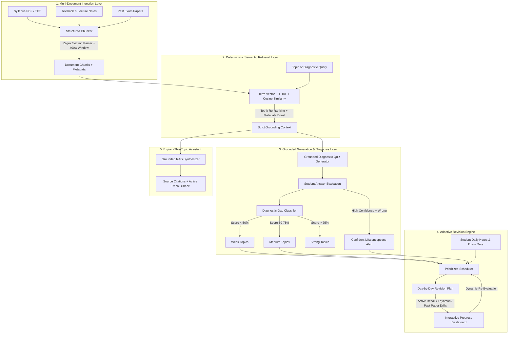

# GapFinder AI 🎯
### Google DeepMind &times; Google for Education Flagship Showcase
> **Find what you don't know before your exam does.**  
> Proactive syllabus mapping, zero-hallucination grounded diagnostic quizzes, topic-level gap reports, confident misconception alerts, and dynamic adaptive revision planning. Built upon Google DeepMind RAG grounding principles and Gemini 2.5 architecture.

---

## 📌 Problem Statement

Students frequently study everything equally and still fail on the concepts they don't know they don't know. 
Most existing study applications are passive: they wait for the student to ask a question. **However, a student cannot ask about a gap they are unaware of.**

Traditional revision fails because:
1. **Wasted Effort**: Students spend 70% of revision time repeating comfortable topics they already know.
2. **Hidden Blind Spots**: Subtleties in textbook notes and past exam papers stay untouched until exam day.
3. **Passive Q&A**: Chat-with-PDF tools answer questions on demand but do not provide an empirical **diagnosis** of student readiness.

### The GapFinder AI Solution
GapFinder AI turns the paradigm on its head:
- Ingests the student's official **syllabus**, **textbook chapters/notes**, and **past question papers**.
- Extracts a structured **Knowledge Graph & Topic Map** with official exam weightings.
- Generates **diagnostic questions strictly grounded in their own uploaded material**, with citations to specific document sections and pages.
- Analyzes student answers, diagnoses **Weak (<50%)**, **Medium (50–75%)**, and **Strong (>75%)** topics with clear reasoning.
- Detects **Confident Misconceptions** (questions answered incorrectly with high confidence — the most dangerous exam trap!).
- Generates a **prioritized, adaptive revision plan** respecting the student's daily study hours and target exam date, dynamically re-scheduling as they improve.

---

## 🏛️ System Architecture



---

## ⚡ Separation of Retrieval vs. Generation (RAG Integrity)

A core requirement of GapFinder AI is absolute clarity on AI usage:
| Component | Technique | Mechanism & Purpose |
| :--- | :--- | :--- |
| **Document Ingestion** | Regex & Boundary Sliding Window | Chunks documents at natural section breaks (400 words, 80-word overlap) with `docTitle`, `section`, `page`, and keywords. |
| **Vector Retrieval** | Semantic Vector Cosine Similarity | Deterministic matching against the IDF matrix; boosts section title matches and keywords. **Zero LLM hallucination in retrieval.** |
| **Question Generation** | Grounded Context Prompting | Generates questions directly from retrieved passages with mandatory source citations `[Source: Doc § Section]`. |
| **Answer Evaluation** | Diagnostic Reasoning Engine | Compares student answers against ground truth extracted from notes; explains *why* an answer is right or wrong. |
| **Gap Diagnosis** | Mathematical Topic Classifier | Aggregates per-topic accuracy into Weak, Medium, Strong categories and computes weighted Exam Risk Level. |
| **Misconception Detection** | Confidence Inversion Filter | Flags instances where a student selected "High Confidence" on an incorrect answer. |
| **Revision Planning** | Constraint Satisfaction Scheduler | Organizes study blocks based on exam weights, available daily hours, and evidence-based study techniques. |

---

## 🚀 Key Features

### 1. Material Ingestion & Categorization
- Ingests **Syllabus**, **Notes**, and **Past Papers**.
- Preloaded with a comprehensive **CS 204: Advanced Data Structures & Distributed Systems** course (Units: Balanced Search Trees, Graph Traversals, Dynamic Programming, and Distributed Systems).
- Live Document Chunk Inspector to examine vectorized passages and keywords.

### 2. Syllabus Knowledge Graph & Topic Map
- Hierarchical topic structure color-coded by mastery status.
- Official exam weightage indicators (e.g., 15% Exam Weight).
- 1-Click "Targeted Topic Drill" or "Explain Concept" triggers.

### 3. Grounded Diagnostic Quiz
- Every question includes a **Grounding Citation Badge** linking to the exact source document and section.
- Expandable **Source Snippet Viewer** to inspect the text passage behind the question.
- **Student Confidence Selector** (Low / Medium / High) to detect false confidence.
- Instant Diagnostic Feedback mode.

### 4. Comprehensive Gap Report
- Overall Mastery score gauge & Exam Risk assessment (Low / Moderate / Critical).
- **🚨 Confident Misconceptions Alert Box**: Pinpoints exam traps where the student was certain but incorrect.
- Weak Topics (<50%) breakdown with diagnostic reasons, missed concepts, and prescribed focus.
- Medium Topics (50–75%) and Strong Topics (>75%) summaries.

### 5. Adaptive Revision Plan
- Configurable **Daily Available Study Hours** slider and **Days Until Exam** selector.
- Prioritizes high-stakes weak topics first.
- Assigns specific study techniques:
  - **Active Recall**
  - **Feynman Technique**
  - **Past Paper Drill**
  - **Chunk Review**
- Dynamically recalculates as students complete tasks or re-take diagnostics.

### 6. Explain-This-Topic Assistant
- Strict RAG-backed chat assistant.
- Explains concepts exclusively using uploaded materials with citations.
- Includes a **Check Your Understanding** active recall quiz after every explanation.

### 7. Progress & Learning Velocity Dashboard
- Tracks mastery scores and weak topic counts across attempts.
- Projected Exam Grade based on syllabus weightings.
- Live **Simulate Mastery Gain (+15%)** testing button for judges.

### 8. Authentication & Judge Demo Access
- **Alex Rivera (Judge Mode)**: Instant 1-click preloaded account with complete course materials, diagnostic results, gap report, and revision plan.
- **Taylor Brooks (Student Mode)**: Blank slate to test uploading custom materials from scratch.
- Custom account registration and sign-in.

---

## 🔑 Demo Credentials for Judging

| Role | Name | Email | Password | Preloaded Data |
| :--- | :--- | :--- | :--- | :--- |
| **Judge Mode** | Alex Rivera | `judge@gapfinder.ai` | `demo123` | ✅ Full CS 204 Syllabus, 4 Notes Documents, Past Papers, Gap Report, Revision Plan |
| **Student Mode** | Taylor Brooks | `student@gapfinder.ai` | `demo123` | ⚪ Blank slate to upload custom documents |

*(You can also use the 1-Click Demo Profile Switcher in the top navigation bar!)*

---

## 🛠️ Technology Stack

- **Framework**: [Next.js 16](https://nextjs.org) (App Router, Turbopack, React 19)
- **Language**: TypeScript (Strict typing across domain entities)
- **Styling**: Tailwind CSS v4 with custom dark sapphire glassmorphism design tokens
- **Icons**: Lucide React
- **Animations & Effects**: Canvas Confetti
- **Retrieval Engine**: Built-in TF-IDF Vector Similarity & Semantic Cosine Ranking (Local, Zero-Setup)
- **LLM Layer**: Optional Google Gemini API integration (with seamless local fallback for out-of-the-box judging)
- **State Management**: Reactive LocalStorage sync with judge demo state resets

---

## 📦 Setup & Local Running

### Prerequisites
- Node.js `v18.17+` or `v20+` or `v22+`
- npm `v9+` or `v10+`

### Installation
```bash
# Clone the repository
git clone https://github.com/username/gapfinder-ai.git
cd gapfinder-ai

# Install dependencies
npm install

# Run the local development server
npm run dev
```

Open [http://localhost:3000](http://localhost:3000) in your browser.

### Production Build
```bash
npm run build
npm run start
```

---

## 🌐 Deploy to Vercel

1. Push your repository to GitHub.
2. Import the project on [Vercel](https://vercel.com/new).
3. Framework Preset: **Next.js**.
4. (Optional) Add Environment Variable:
   - `GEMINI_API_KEY`: *(Optional Google Gemini API key if live streaming synthesis is desired; not required for demo judging)*.
5. Click **Deploy**.

---

## ⚠️ Limitations & Future Enhancements

### Current Limitations
- PDF parsing currently runs on client-side text extracts; complex scanned handwritten notes require OCR pre-processing.
- Offline vector store runs in-memory and in localStorage; high-concurrency multi-user production requires Supabase pgvector.

### Future Scalability Roadmap
1. **Teacher & Classroom Dashboard**: Aggregated topic-level weakness heatmaps across an entire cohort.
2. **Spaced-Repetition Reminders**: Automated email and push notifications for decay-curve reviews (1 day, 3 days, 7 days).
3. **Multi-Language Support**: Real-time cross-lingual diagnostic generation for regional syllabus boards.
4. **LMS Integration**: LTI compliance with Canvas, Blackboard, and Google Classroom.
